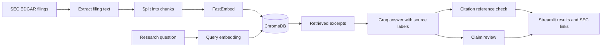

<div align="center">

# FilingsIQ

### SEC filing research, grounded in the source.

An AI-assisted research tool for exploring company risks in SEC Form 10-K filings. Search filing excerpts, review source-linked answers, and inspect an LLM-assisted claim check in one Streamlit interface.

[Getting started](#getting-started) · [How it works](#how-it-works) · [Limitations](#verification-and-limitations)

</div>

---

## Overview

FilingsIQ combines semantic retrieval with language-model answer generation to help users research business risks disclosed in SEC filings. The application retrieves passages from a local ChromaDB index, asks Groq to answer using those excerpts, checks citation references, and presents the relevant SEC links for review.

> **Research aid, not financial advice.** Generated answers and verification statuses require human review against the original filing.

## What you can do

- Search indexed SEC Form 10-K excerpts using natural-language questions.
- Research Apple, Microsoft, and NVIDIA individually or compare companies.
- Review numbered source references, filing dates, excerpts, and SEC links.
- Inspect citation-reference checks and LLM-assisted claim-review findings.

## Technology

| Layer | Technology |
| --- | --- |
| User interface | Streamlit |
| Answer generation and claim review | Groq API |
| Embeddings | FastEmbed (`BAAI/bge-small-en-v1.5`) |
| Vector search | ChromaDB |
| Filing source | SEC EDGAR Form 10-K filings |
| Language | Python |

## How it works



The Streamlit interface in `app.py` calls `src/agent/basic_rag.py` for retrieval, answer generation, and verification. The deployment-ready ChromaDB index is included as a snapshot; raw filing downloads and intermediate processing files remain excluded from Git.

## Getting started

### Requirements

- Python 3.11 recommended.
- A Groq API key and a model ID available to your account.
- Internet access to download SEC filings and the FastEmbed model on first use.

### 1. Clone and install

```powershell
git clone https://github.com/AbhishekCodingPrograms/FilingsIQ.git
cd FilingsIQ

python -m venv .venv
.\.venv\Scripts\Activate.ps1
python -m pip install --upgrade pip
python -m pip install -r requirements.txt
```

### 2. Configure credentials

Create a `.env` file in the repository root:

```dotenv
GROQ_API_KEY=your_groq_api_key
GROQ_MODEL=your_supported_groq_model
```

Keep `.env` private. It is excluded by `.gitignore`; never add credentials to source code, screenshots, or commits.

### 3. Build the local filing index

Run these commands from the repository root:

```powershell
python -m src.ingestion.download_filings
python -m src.retrieval.chunk_filings
python -m src.ingestion.embed_chunks
python -m src.retrieval.build_vector_db
```

This downloads the configured companies' latest 10-K filings, creates chunks and embeddings, and builds the `filingsiq_10k` ChromaDB collection. The source files and resulting index are stored under `data/` and `chroma_db/`. Rebuilding replaces the existing project collection.

Before using the SEC downloader, review its User-Agent in `src/ingestion/download_filings.py` and use appropriate contact information. Follow SEC fair-access guidance.

### 4. Launch the app

```powershell
streamlit run app.py
```

Open the local URL printed by Streamlit. Example questions:

- “What business risks does Apple describe in its latest 10-K?”
- “Compare Apple's and Microsoft's disclosed risk factors.”
- “What risks does NVIDIA describe related to competition?”

## Repository layout

```text
app.py                         Streamlit interface
src/
  agent/
    basic_rag.py               Live RAG and answer-verification flow
    citation_verifier.py       LLM-assisted claim review
    graph.py                   Separate placeholder LangGraph workflow
  ingestion/
    download_filings.py        Download configured SEC filings
    embed_chunks.py            Generate embeddings and metadata
    combine_chunks.py          Combine per-company chunk files
    verify_filings.py          Inspect downloaded filing records
  retrieval/
    chunk_filings.py           Split filing text into chunks
    build_vector_db.py         Create the local ChromaDB collection
    search_filings.py          Command-line semantic search
requirements.txt               Python dependencies
```

Generated `data/raw/`, `data/processed/`, and `.venv/` files are not tracked by Git. The reviewed `chroma_db/` deployment snapshot is tracked so the hosted app can start with its indexed collection.

## Verification and limitations

- **Citation-reference check:** checks that cited source numbers exist among retrieved sources. It does not establish that a source supports the associated statement.
- **Claim review:** an LLM evaluates answer claims against retrieved excerpts. It is not an independent audit and cannot guarantee factual accuracy.
- **Retrieval coverage:** relevant filing text may not be retrieved; incomplete evidence can affect the answer and review.
- **Interpretation:** missing evidence does not prove a company has no corresponding risk. A `PASS` status is not a substitute for human review.
- **Source of truth:** check material claims against the original filing linked in the app, especially before relying on comparisons or time-sensitive conclusions.

## Deploy on Streamlit Community Cloud

The repository includes a ChromaDB snapshot containing the `filingsiq_10k` collection, so a fresh deployment has the index it needs. The snapshot contains SEC filing excerpts and source metadata; it does not contain API credentials. The application accepts credentials from Streamlit secrets or environment variables, and continues to load `.env` for local development.

1. Open [share.streamlit.io](https://share.streamlit.io/) and sign in with GitHub.
2. Select **Create app**, choose this repository, the `main` branch, and `app.py` as the main file.
3. Open the app's **Settings → Secrets** and enter:

   ```toml
   GROQ_API_KEY = "your_groq_api_key"
   GROQ_MODEL = "your_supported_groq_model"
   ```

4. Save the secrets and deploy/reboot the app. Do not put these values in GitHub files, commits, or the repository's README.
5. Submit a research question and verify that the answer displays sources from the indexed SEC excerpts.

The index is a snapshot and does not update automatically when the SEC publishes new filings. To refresh it, rebuild `chroma_db/` using the local indexing steps, then commit and push the updated database snapshot. The ChromaDB version is pinned in `requirements.txt` to match the persisted index format.

If a secret is missing, the app reports which setting needs to be added. If the index cannot be loaded, check that the repository's `chroma_db/` files were included in the deployment.

## Security

- Store API credentials in environment variables or your hosting provider's secret manager.
- Never commit `.env`, `.streamlit/secrets.toml`, private data, or credentials.
- The committed vector index contains excerpts from public SEC filings and source metadata. Do not commit `.env`, credentials, or unreviewed private filing data.

## Disclaimer

FilingsIQ is an educational research project and is not investment, legal, or financial advice. Verify research against the original SEC filings and consult qualified professionals before making decisions.

## Author

**Abhishek Maurya**
